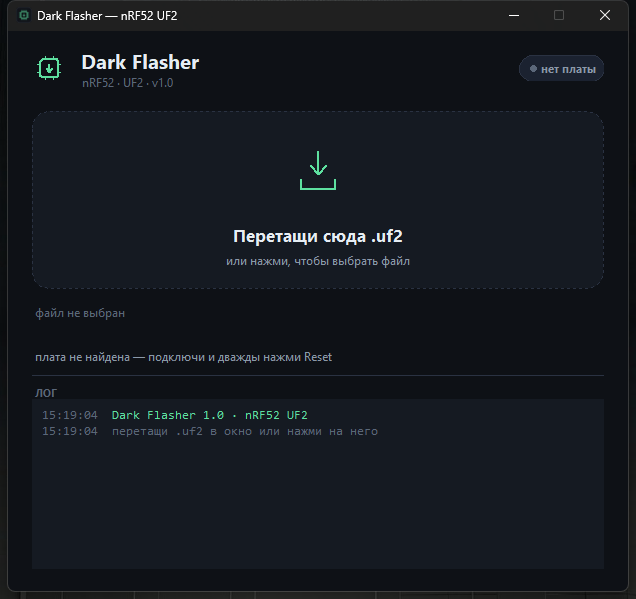

# Dark Flasher 1.0

Тёмная прошивалка `.uf2` для nRF52 (nice!nano и другие платы с Adafruit-совместимым
UF2-загрузчиком). Windows.



## Как пользоваться

1. Запусти `DarkFlasher\DarkFlasher.exe` (папку `DarkFlasher` держи целиком — рядом
   лежит `_internal`). Или `Запуск.bat`, если хочешь запускать из исходника.
2. Перетащи `.uf2` в большое окно. Можно просто кликнуть по нему и выбрать файл.
3. Плату переведи в режим загрузчика: **дважды нажми Reset**.
4. Программа сама поймает появившийся UF2-диск и запишет файл. Если диск уже был —
   начнёт сразу.

Кнопок нет специально: `Esc` — закрыть, `Ctrl+O` — выбрать файл.

Если плата ещё не в загрузчике, окно переходит в «Жду плату…» и ждёт сколько нужно:
можно сначала перетащить файл, а потом нажать Reset.

## SmartScreen

`DarkFlasher.exe` не подписан сертификатом, поэтому Windows может показать
«Windows protected your PC». Это не вирус — жми **«Подробнее» → «Выполнить всё равно»**.

Убрать это совсем у всех можно только платным code-signing сертификатом;
самоподписанный не помогает. Если Python установлен — запускай через `Запуск.bat`:
он стартует подписанный `pythonw.exe`, и красного окна нет.

## Почему Explorer ругался «0x80070022: в устройство вставлен неверный диск»

Это `ERROR_WRONG_DISK`, и он почти всегда про то, что **том исчез в момент операции**:

- UF2-загрузчик уходит в ребут сразу, как принял последний блок файла. Windows в этот
  момент ещё закрывает файл/обновляет FAT — тома уже нет → «неверный диск». Сама
  прошивка при этом обычно уже записана.
- Второй сценарий: диск пересоздался, а Explorer помнит старую букву/старое окно.
  Копирование в «старый» том падает сразу.

Dark Flasher поэтому:

- ищет том по **Volume GUID** и проверяет в нём `INFO_UF2.TXT`, а не по букве `E:`;
- пишет напрямую, без Explorer'а, с write-through и точным учётом записанных байт;
- стартует в момент появления тома, а не когда дотащил мышку;
- обрыв связи в самом конце считает успехом — все блоки уже приняты.

## Логи

`darkflasher.log` рядом с `DarkFlasher.exe` (в папке `DarkFlasher`). Если запускаешь
`.py` — рядом с `DarkFlasher.py`. Если окно вылетело — рядом появится
`darkflasher-trace.log` с трейсбеком; пришли его и `darkflasher.log`.

Проверить файл из консоли:

```
python DarkFlasher.py --check "C:\path\firmware.uf2"
```

Прошить из консоли (ждёт плату 60 секунд):

```
python DarkFlasher.py --flash "C:\path\firmware.uf2"
```

Командная строка — только у `.py`: у `DarkFlasher.exe` консоли нет, он чисто оконный.

## Мелочи

- **UF2 по COM не шьётся.** У загрузчика есть serial DFU (`adafruit-nrfutil`), но это
  другой формат — zip-пакет, и он не быстрее/надёжнее. Для `.uf2` правильный путь —
  USB-диск, что программа и делает.
- **Номера COM-портов растут** потому, что у каждого чипа свой USB-серийник: Windows
  заводит новый экземпляр устройства и даёт следующий свободный COM. На прошивку не
  влияет.
- **В этих `.uf2` нестандартный `UF2_MAGIC_END` (`0x0AB16F30`)** — так собирает
  `uf2conv.py` под nice!nano-загрузчик 0.10.0. Программа понимает и его, и стандартный
  `0x0FE2E000`.
