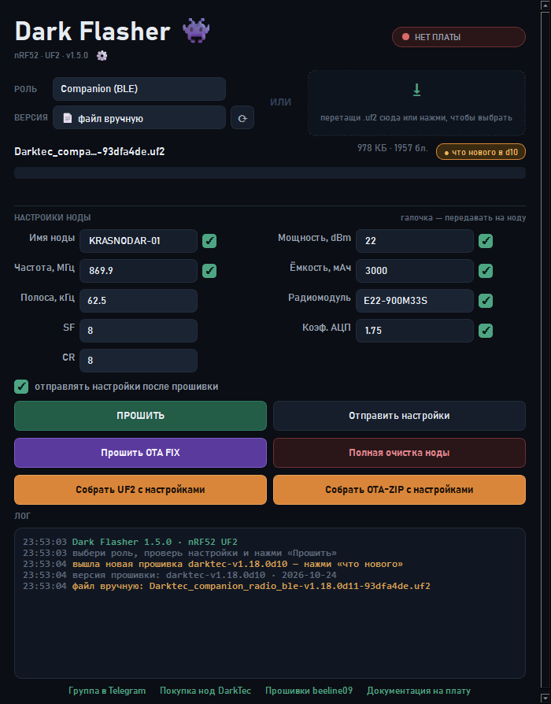

# Dark Flasher 1.5.0 👾

Прошивалка для нод **DarkTec** на nRF52840: выбираешь роль и версию прошивки, заполняешь настройки — программа сама скачивает файл, прошивает и записывает настройки в ноду по USB. Отдельно можно поставить загрузчик **OTAFIX** (обновление по воздуху) и стереть память ноды.

## Что умеет

- **8 ролей**: Companion (BLE/USB), Repeater, Repeater + RS232, Room server, Sensor + GPS, Terminal chat, KISS modem.
- **Версии прошивок** берёт из релизов GitHub — показывает пять последних сборок начиная с d7, скачивает нужную.
- **Список обновляется сам** — примерно раз в полчаса (без жёсткого таймера). Локальные dev-сборки подхватываются сразу, как только изменилась папка, и работают без GitHub/интернета.
- **«Что нового»** — кнопка рядом с версией: открывает заметки из релиза GitHub. Если с прошлого запуска вышла новая прошивка, кнопка подсвечивается оранжевым.
- **Проверяет sha256** скачанного файла, чтобы не прошить битый.
- **«Прошить OTA FIX»** — ставит на ноду загрузчик **OTAFIX**: с ним работает обновление по воздуху
  (Bluetooth, Nordic DFU). Файл загрузчика для платы DarkTec (`update-*promicro_nrf52840*_nosd.uf2`)
  берётся из последнего релиза OTAFIX на GitHub, sha256 проверяется.
- **«Полная очистка ноды»** — стирает **всё**: прошивку, настройки, ключи, контакты и каналы.
  В ноде остаётся только загрузчик; стирающий образ из официального флешера MeshCore вшит
  в саму программу.
- **Собирает файлы с вшитыми настройками**: «Собрать UF2 с настройками» и «Собрать OTA-ZIP с настройками». Программа
  вписывает в образ блок заводских настроек (метка `DARKTEC-FACTORY`, имя, канал, мощность,
  ёмкость, модуль), и прошивка при первом старте применяет их сама. UF2 — для обычной
  прошивки, zip — для обновления по воздуху (bootloader OTAFIX, приложения Nordic DFU).
  Готовый файл ложится в подпапку `built` рядом с прошивкой, путь пишется в лог оранжевым.
- **Пишет настройки в ноду**: имя, канал (частота/полоса/SF/CR), мощность, ёмкость батареи, радиомодуль, коэффициент АЦП.
- **Галочки у настроек**: что выключено — то не уходит на ноду и не вшивается в UF2/OTA. У радио (частота, полоса, SF, CR) одна общая галочка, у мощности и радиомодуля — свои.
- **LR2021**: для такой сборки отключается только радиомодуль; частота, мощность и остальные настройки остаются.
- **Один прогресс** на всю операцию: скачивание → прошивка → настройки.
- Помнит настройки между запусками — в exe они лежат в `%APPDATA%\DarkFlasher\darkflasher.json`, при запуске из исходников — в `darkflasher.json` рядом с проектом. Старый файл рядом с exe подхватывается при первом запуске.
- Ссылки на группу, покупку нод, прошивки beeline09 и документацию — внизу окна.

## Как прошить

1. Скачай [последний релиз](https://github.com/MacMillan25/DarkFlasher/releases/latest) и положи `DarkFlasher.exe` в любую папку.
2. Запусти `DarkFlasher.exe`.
3. Выбери **роль** и **версию** прошивки.
4. Проверь настройки: имя, канал, мощность, ёмкость, модуль. Если имя оставить пустым — оно не изменится.
5. Нажми **ПРОШИТЬ**.
6. Плату переведи в загрузчик: **быстро нажми RESET два раза**. Появится диск `NRF52BOOT` — программа поймает его сама.
7. Дальше всё автоматически: запись → перезагрузка → поиск ноды по COM → отправка настроек.

Если плата уже в загрузчике — программа начнёт сразу.

### Что означают статусы

| Статус | Значение |
|---|---|
| `BOOT · можно прошивать` | плата в загрузчике, виден UF2-диск |
| `COM5 · нода на связи` | плата работает, порт найден, настройки можно писать. Если nRF-портов несколько, у статуса есть `▾` — по клику выбирается нужный |
| `НЕТ ПЛАТЫ` | ничего не подключено |

### Если что-то не так

- **«нода не ответила ни на одном порту nRF»** — проверь кабель и что нода не в загрузчике. Настройки не отправились, прошивка при этом уже записана.
- **SmartScreen** — «Подробнее» → «Выполнить всё равно».
- Настройки на некоторых ролях (Terminal chat, KISS modem) пока не поддерживаются — они не понимают CLI.

## Обслуживание ноды

Две кнопки под «Прошить» и «Отправить настройки» — для загрузчика и для полной очистки.
Обе работают как прошивка: плату надо перевести в загрузчик (**RESET два раза**),
дальше программа сама поймает диск и запишет файл.

### Прошить OTA FIX

Ставит загрузчик **OTAFIX** — форк Adafruit-загрузчика с обновлением по воздуху
(Bluetooth, Nordic DFU). Он же падает в режим DFU, если прошивка не запустилась, —
ноду на крыше не придётся снимать из-за неудачного обновления.
Плата DarkTec собирается как `promicro_nrf52840`, её файл и берётся из релизов OTAFIX.

- файл скачивается один раз в `%APPDATA%\DarkFlasher\boot\` и дальше берётся оттуда;
- sha256 сверяется по данным релиза;
- если в папке `boot` (в `%APPDATA%\DarkFlasher\boot` или рядом с exe) лежит свой
  `update-*promicro_nrf52840*.uf2`, программа возьмёт его и в GitHub не полезет.

Файл проверяет сам загрузчик: битый или от чужой платы он не примет и останется как был,
так что испортить ноду этой кнопкой нельзя.

После записи нода перезагружается. Если на ней был старый загрузчик, дальше стоит нажать
**«Полная очистка ноды»** — иначе останется старый раздел данных и настройки могут
вести себя странно.

### Полная очистка ноды

Стирает **всё**: прошивку, настройки, ключи, контакты, каналы и привязки Bluetooth.
В ноде остаётся только загрузчик — прошивку надо записать заново.
Кнопка сначала спрашивает подтверждение.

Как это работает: в программу вшит готовый стирающий образ из официального флешера
MeshCore — `FLASH_ERASE_nrf52_softdevice_v6.uf2`. Это обычное приложение nRF52 под
SoftDevice v6 (как во всех прошивках DarkTec): программа проверяет его sha256, пишет
на диск загрузчика, плата запускает образ, он стирает флеш от `0x26000` до загрузчика
и возвращает плату в режим UF2. Дальше — «Прошить».

- Стирается и прошивка, и обе файловые системы (ключи, настройки, контакты, каналы,
  привязки Bluetooth) — образ работает с флешем напрямую, а не копирует байты через UF2.
- Загрузчик и SoftDevice остаются: без них плату не поднять без программатора.
- Образ рассчитан на SoftDevice **v6** (S140 6.1.1). Для SD v7 нужен другой файл —
  в флешере MeshCore он называется `FLASH_ERASE_nrf52_softdevice_v7`.

Почему нельзя просто «пустым uf2»: загрузчик не пишет по UF2 в хвост области приложения
(`0xEA000..0xF4000`, `DFU_APP_DATA_RESERVED`), а именно там лежат ключи и настройки.
Поэтому стирает не запись байтов, а маленькая прошивка-стиратель.

После очистки плата остаётся в загрузчике — можно сразу жать «Прошить».

Образ стирания — из флешера MeshCore (<https://flasher.meshcore.io>), лицензия MIT;
в репозитории он лежит в `assets/` и вшивается в exe при сборке.

## Где лежат прошивки

- Скачанные из GitHub — в `%APPDATA%\DarkFlasher\firmware\<env>.uf2`.
- Загрузчик OTAFIX — в `%APPDATA%\DarkFlasher\boot\`; свой `update-*.uf2` можно положить
  в папку `boot` рядом с exe.
- Рядом с exe тоже читается папка `firmware` — можно положить файл вручную.
- Если выбрал файл вручную (клик по зоне или перетаскивание), в списке версий появляется пункт «файл вручную»: шьётся именно он, настройки после прошивки не отправляются.

## Сборка

`build.cmd` — соберёт `dist\DarkFlasher.exe` (Python 3.10+, PyQt6, PyInstaller, pyserial).
Из исходников — `Запуск.bat` (запускает `darkflasher_qt.py`).

## Ссылки

- [Группа в Telegram](https://t.me/DarkElectronics)
- [Покупка нод DarkTec](https://t.me/Dark_Electronics)
- [Прошивки beeline09](https://beeline09.github.io/darktec/)
- [Документация на плату](https://disk.yandex.ru/i/_Y-lxwDZrS1TRA)

## Лог

Ошибки пишутся в `%APPDATA%\DarkFlasher\darkflasher-error.log`.
