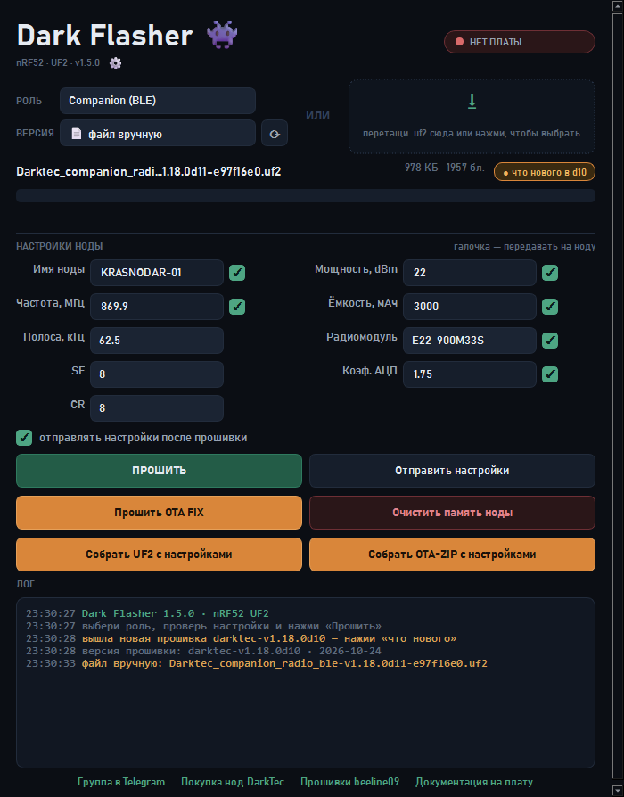

# Dark Flasher 1.5.0

Windows 10/11 x64. Две новые кнопки — загрузчик **OTAFIX** и очистка памяти ноды. Новых ролей и версий прошивки нет.

**Установка:** скачай `DarkFlasher.exe` и положи в любую папку. Настройки и скачанные прошивки при первом запуске появятся в `%APPDATA%\DarkFlasher`; старый `darkflasher.json` рядом с exe подхватится автоматически.

## Главное

- **«Прошить OTA FIX»** — ставит на ноду загрузчик **OTAFIX**, с которым работает обновление по воздуху (Bluetooth, Nordic DFU). Плата DarkTec собирается как `promicro_nrf52840`, поэтому берётся её файл `update-*promicro_nrf52840*_nosd.uf2` из последнего релиза OTAFIX. Файл скачивается один раз, sha256 сверяется по данным релиза; свой файл можно положить в папку `boot` — он приоритетнее скачивания.
- **«Очистить память ноды»** — стирает настройки, ключи, контакты, каналы и привязки Bluetooth. **Прошивка и загрузчик остаются**: нода запускается как новая, с новыми ключами и каналами. Кнопка сначала спрашивает подтверждение.
- **Кнопки стоят под «Прошить» и «Отправить настройки»**, окно стало выше ровно на этот ряд. Во время операции все кнопки блокируются, как и раньше.

## Как работает OTAFIX

Загрузчик OTAFIX — это форк Adafruit-загрузчика с рабочим DFU по Bluetooth: он принимает стандартный Nordic DFU пакет (его Dark Flasher и так умеет собирать — «Собрать OTA-ZIP с настройками»), быстрее передаёт и сам уходит в DFU, если прошивка не запустилась. Ноду на крыше из-за неудачного обновления снимать не придётся.

- Файл загрузчика не является непрерывным образом: в нём образ загрузчика и строка UICR по разным адресам. Поэтому «Прошить OTA FIX» пишет файл как есть, а содержимое проверяет сам загрузчик на плате.
- В логе показывается текущий загрузчик платы (из `INFO_UF2.TXT`), версия OTAFIX и sha256 скачанного файла.
- После записи нода перезагружается — запускается прошивка или, если она невалидна, режим DFU. Настройки при этом не отправляются.

Последовательность для ноды со старым загрузчиком: **Прошить OTA FIX → Очистить память ноды → прошить нужную версию**. Очистка нужна потому, что после смены загрузчика старый раздел данных остаётся и настройки могут вести себя странно.

## Что именно стирает «Очистить память ноды»

Стираются только разделы данных в верхней части флеша:

| Роль | Раздел данных |
|---|---|
| Companion (BLE/USB) | `0xD4000..0xF4000` — ExtraFS (контакты, каналы) и InternalFS (ключи, настройки, привязки) |
| Остальные роли | `0xED000..0xF4000` — InternalFS (ключи, настройки) |

Прошивка лежит ниже `0xD4000` (у Companion — до `0xD4000`, у остальных — до `0xED000`), загрузчик начинается с `0xF4000`. Программа собирает UF2 из одних `0xFF` на этот диапазон: загрузчик перед записью страницы её стирает, поэтому раздел действительно становится пустым, а прошивка и загрузчик остаются на месте.

Если прошивка была собрана с вшитыми настройками, после очистки блок заводских настроек применится снова при первом старте — это ожидаемо.

## Внутренние изменения

- `FlashJob` пишет любой файл по пути и размеру, без обязательного `Uf2Info`: образ очистки и файл загрузчика проверяются по-разному.
- Общая закачка по HTTP с проверкой sha256 (`_download_to`) — ею качаются и прошивки, и загрузчик OTAFIX.
- Генератор образа очистки (`build_erase_uf2`) принимает только диапазон внутри разделов данных: стереть область прошивки или загрузчика он откажется.
- Код записи UF2, разбора образа и сборки OTA-пакета не менялся.
- Версия программы — **1.5.0**.
