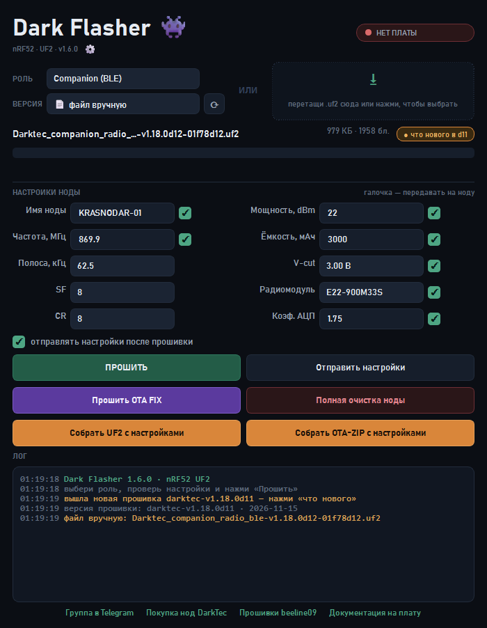

# Dark Flasher 1.6.0

Windows 10/11 x64. Новое: настройка **V-cut** — порог отключения ноды по низкому напряжению. Теперь её можно задать заранее, вместе с остальными настройками, в том числе зашить в UF2/OTA. Новых ролей нет.

**Установка:** скачай `DarkFlasher.exe` и положи в любую папку. Настройки и скачанные прошивки при первом запуске появятся в `%APPDATA%\DarkFlasher`; старый `darkflasher.json` рядом с exe подхватится автоматически.

## Главное

- **V-cut в настройках ноды.** В прошивке d11 порог отключения уже был — но только в меню самой ноды: заранее, из программы, его было не задать. Теперь в «Настройках ноды» есть пункт `V-cut`: `3.40 В · штатный`, `3.00 В`, `2.50 В`, `2.00 В`, `1.00 В`. Это тот же порог, что листает меню `[ Darktec ]`; ниже штатного он нужен для стенда с ЛБП и для слабых банок.
- **Уходит на ноду вместе с настройками** — командой `set darktec.lowbat`, после прошивки, как имя или мощность. «Штатный» не передаётся и не вшивается: у ноды остаётся её порог (по умолчанию 3.40 В), а на прошивках старше d12 команда не отправляется вовсе — раньше она отвечала `Unknown command` и срывала всю пачку настроек.
- **И вшивается в файл.** «Собрать UF2 с настройками» и «Собрать OTA-ZIP с настройками» теперь пишут V-cut в блок заводских настроек: нода при первом старте применит порог сама, ничего не трогая руками. В том числе при обновлении по воздуху.
- **Галочка, как у остальных настроек:** снял — V-cut не уходит на ноду и не вшивается в образ.

## Важно про версию прошивки

Поле под V-cut в блоке заводских настроек было с самой раскладки v1, но прошивка его не читала: d11 и старше просто не знают этот флаг. Поэтому:

- в прошивку **d12 и новее** V-cut вшивается;
- в старую прошивку (d11, d10…) программа его **не пишет** и честно говорит об этом в логе — иначе значение потерялось бы молча: блок запомнился бы как применённый, и после обновления на d12 порог уже не приехал бы;
- на старую ноду V-cut всё равно можно отправить кнопкой «Отправить настройки» — команда есть начиная с d12;
- **`set darktec.lowbat` в d12 починен.** До неё команда была объявлена, но из-за ошибки в разборе префикса отвечала `Unknown command` — то есть не работала ни в одной прошивке. В d12 исправлено.

Как это устроено: в заголовке пустого блока заводских настроек прошивка d12 объявляет свои возможности — байты `V` и версия списка. Программа смотрит их и вшивает V-cut только туда, где возможность объявлена. Раскладка блока не менялась (по-прежнему `kVersion = 1`), поэтому d11 принимает блок целиком и берёт из него всё, кроме V-cut.

## Внутренние изменения

- `FLAG_LOWBATT` (бит 4) в блоке заводских настроек и его применение в `DarktecBoard::applyFactoryConfig()` — правка прошивки, версия **1.18.0d12**.
- `factory_caps()` в `DarkFlasher.py`: перед вшиванием программа смотрит байты возможностей в заголовке блока, а не пишет флаги вслепую.
- `pack_factory_payload()` получил набор возможностей: без `vcut` поле 50 остаётся нулевым, флаг не выставляется.
- У ролей без блока заводских настроек (KISS modem, Terminal chat) сборка с настройками отклоняется сразу с понятным сообщением.
- В логе сборки — пометка `V-cut 2.50 В` в строке параметров и предупреждение, если вшить не удалось.
- Версия программы — **1.6.0**.
